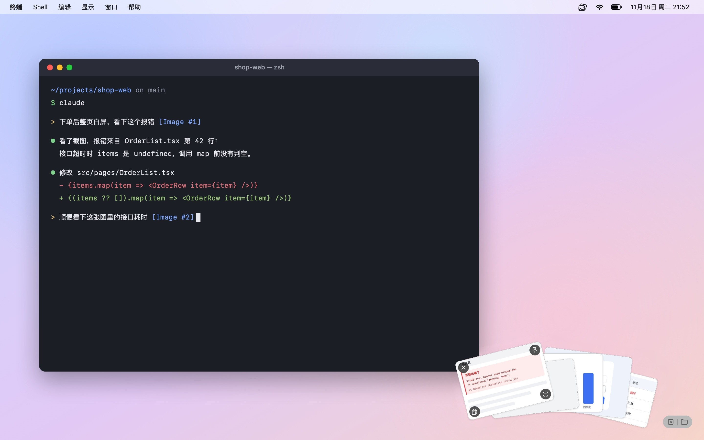
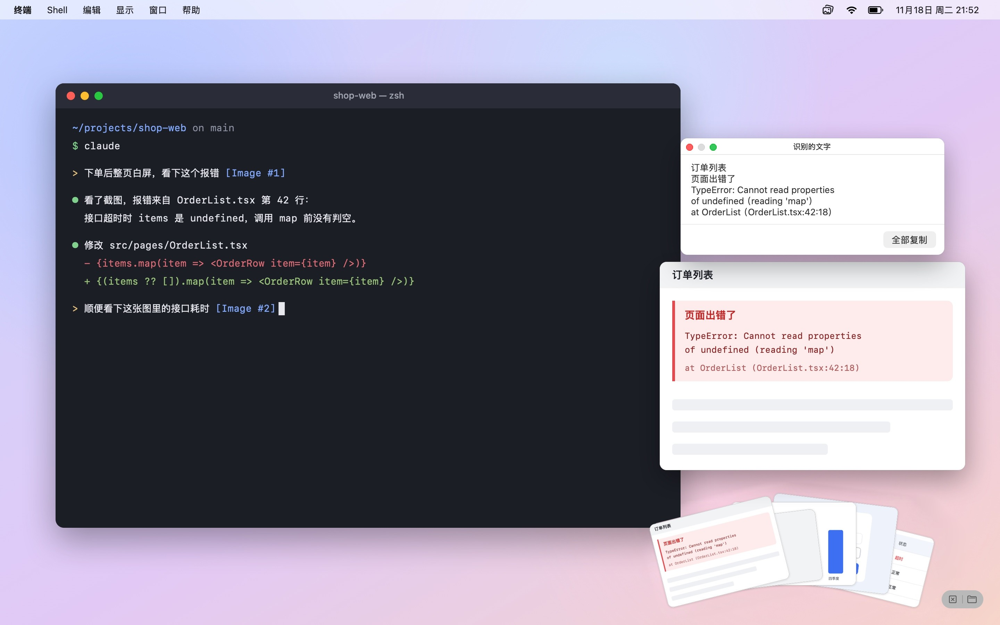

<p align="center"></p>

<h1 align="center">PicBox</h1>

<p align="center">Take a screenshot, drag it into the terminal, and your agent can see it.</p>

<p align="center">PicBox saves every screenshot as a file, so you can drag it into the terminal or copy its path for Claude Code or Codex.<br>A free, open-source Mac menu bar app.</p>

<p align="center"><a href="#install">Install</a> · <a href="README.md">中文</a></p>

When you work with Claude Code or Codex in the terminal, you often need to show it an image: an error page, a design mockup, a chart. But ⌘V in the terminal only pastes text, and a screenshot lives only on the clipboard. You have to save it as a file first, then drag it in or copy its path.

PicBox skips the saving step. As soon as a screenshot lands on the clipboard, it's saved to `~/Pictures/PicBox` and a thumbnail pops up in the bottom-right corner of the screen:

- **Drag into the terminal**: Claude Code gets an image attachment (`[Image #1]`); a plain terminal gets the file path
- **Copy the path**: click a thumbnail to copy its path, with spaces already escaped, then ⌘V in the terminal
- **Pin to the screen**: the image floats on top so you can compare while the agent edits code
- **Recognize text**: one click turns an error screenshot into text you can paste to the agent. Works offline, for Chinese and English
- **Auto cleanup**: screenshots are kept for 14 days by default, then deleted

<p align="center"></p>

## Usage

- The 5 most recent screenshots fan out like playing cards, newest on the left. Hover over one to pull it to the front
- Screenshots, images copied in chat apps or browsers, and image files copied in Finder are all saved
- Hover over a thumbnail to show four corner buttons: top-left hides it, top-right pins it, bottom-left copies the image, bottom-right recognizes text
- Double-click to open the original in Preview. Shift-click to select several, then drag one to drag them all
- Drag a pinned image to move it; drag its edges or corners to resize
- The pill button in the bottom-right clears all thumbnails or opens the screenshot folder. Hold and drag it to move the whole shelf
- Set how many days to keep screenshots from the menu bar icon

The app's interface is in Chinese.

<p align="center"></p>

## Install

Download `PicBox-<version>.zip` from [Releases](https://github.com/cyanext/PicBox/releases), unzip it and drag PicBox into Applications. The first time you open it, macOS says it can't verify the developer. Go to System Settings › Privacy & Security and click "Open Anyway" at the bottom.

Requires macOS 13 or later, on Apple silicon or Intel. Once it's running, the menu bar shows an icon of two stacked pictures; check 登录时自动打开 (Open at Login) there to start it automatically. When a new version is out, PicBox tells you, and clicking 更新 (Update) downloads and installs it.

## Privacy

- Screenshots are stored only in `~/Pictures/PicBox` on your Mac and are never uploaded
- Content marked as concealed, such as passwords copied from a password manager, is never saved
- Auto cleanup deletes only screenshots PicBox saved itself; other files in the folder are left alone
- The only network access is a daily check for new versions on GitHub: a single request with no information about your Mac

## Build from source

Requires the Xcode command line tools:

```bash
make install
```

## License

[MIT](LICENSE)
