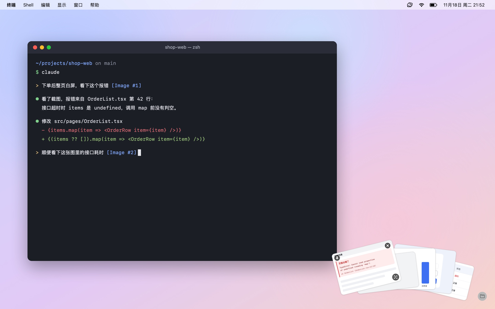
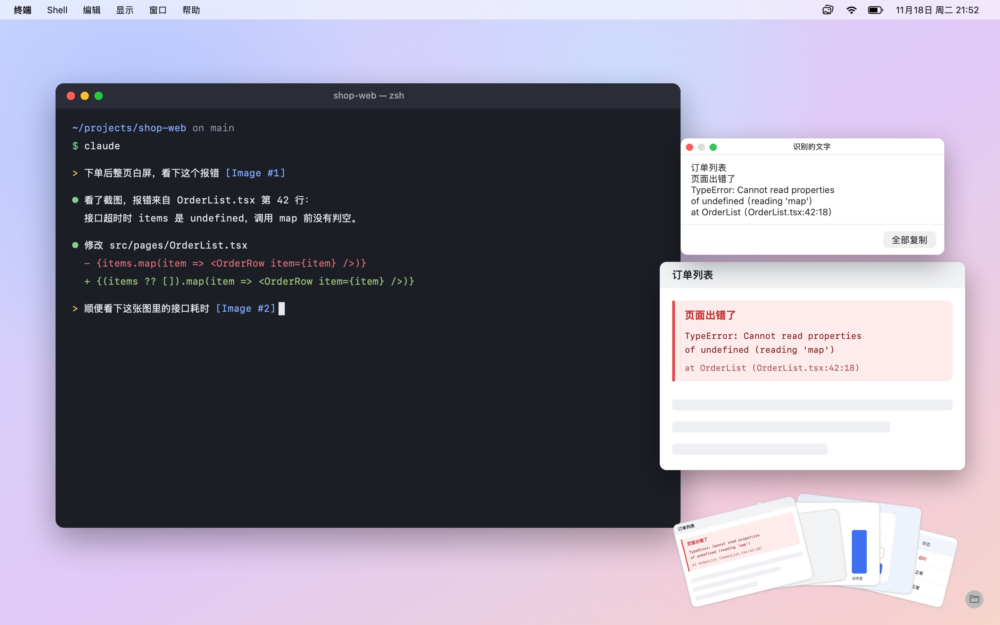

<p align="center"></p>

<h1 align="center">PicBox</h1>

<p align="center">截图后直接拖进终端，或者一键复制路径，给 agent 看图不用再先存文件。</p>

<p align="center"></p>

## 为什么需要它

在终端里用 Claude Code、Codex 这类 agent，经常要给它看图：页面报错、设计稿、数据图表。可终端没法直接粘贴图片，⌘V 只能贴文字。截图只在剪贴板里，想给 agent 看，得先把图存成文件，再拖进终端，或者复制文件路径贴进去。

PicBox 把「先存下来」这一步省掉了：截图一出现在剪贴板里，就自动存进 `~/Pictures/PicBox`，同时在屏幕右下角弹出一张缩略图。接下来二选一：

- **拖进终端**：按住缩略图拖到终端里放下。Claude Code 会把它当成一张图片附件（`[Image #1]`），普通终端里是这张图的文件路径。
- **一键复制路径**：单击缩略图，文件路径就复制好了，到终端里 ⌘V 贴进去，agent 读路径就能看到图。

## 功能

- **自动存图**：截图、在聊天软件或浏览器里复制图片、在访达里复制图片文件，都会存一份。
- **扇形暂存区**：最近 5 张像扑克牌一样摊开，最新的在最左、盖在最前面。鼠标移到哪张，那张抽出来、切到最上面。
- **拖出去**：拖到终端、聊天框、文档、访达里放下。Shift 单击多选，拖其中一张就一起拖出去。
- **复制路径**：单击一张，复制它的文件路径，空格已经转义好，贴进终端就能用。
- **复制图片**：鼠标停在一张上，点左下角的复制按钮，图片本身进剪贴板，在聊天软件、文档里 ⌘V，在 Claude Code 里 Ctrl+V。
- **钉在屏幕上**：点图钉，图片浮在屏幕上，agent 改代码时对照着看。
- **识别文字**：报错截图点一下识别，文字整段复制给 agent，比发图省事。离线识别，中英文都认。
- **自动清理**：默认保留 14 天，过期的截图自动删掉。

<p align="center"></p>

## 安装

```sh
make install
```

装到「应用程序」并打开，菜单栏出现两张图片叠在一起的图标。需要 macOS 13 或更新的版本。想开机自动运行，在菜单栏图标里勾上「登录时自动打开」。

## 使用

- 单击缩略图复制路径，双击用预览打开原图。
- 鼠标停在一张上，四个角出现按钮：左上 × 收起，右上图钉钉在屏幕上，左下复制图片，右下识别文字。
- 右下角的文件夹按钮点一下打开截图目录，按住拖动可以把整个暂存区挪到别处，位置会记住。
- 钉住的图按原图大小显示，太大会自动缩小。拖图片移动，拖边缘或角缩放。
- 识别出的文字点「全部复制」复制整段，也可以选中一部分按 ⌘C。
- 菜单栏图标里可以打开截图目录、收起全部缩略图、设置保留天数。

## 许可

[MIT](LICENSE)
